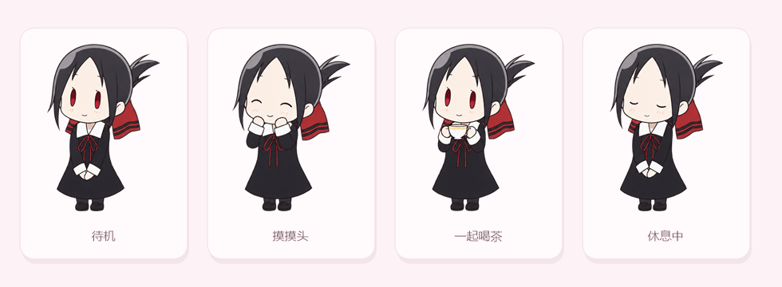
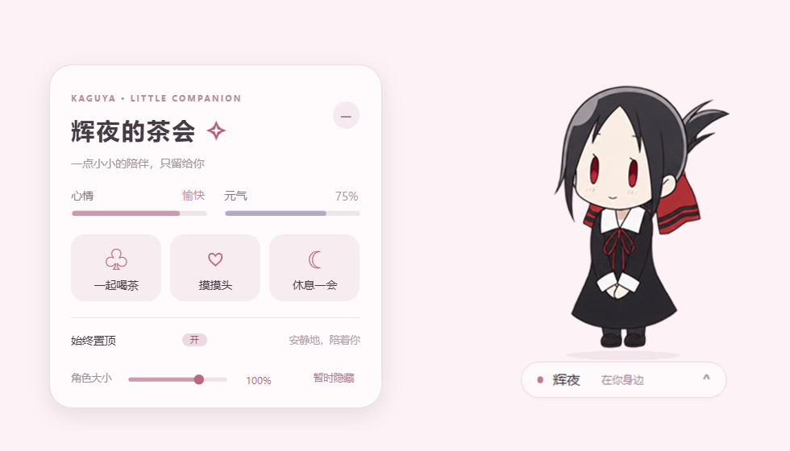
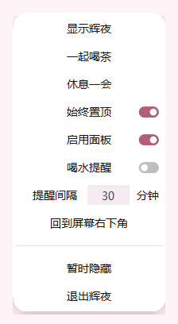

<div align="center">

# 辉夜桌宠

把四宫辉夜请到你的 Windows 桌面上。

她会陪你喝茶、打瞌睡，也会在你忙碌的时候安静地待在屏幕一角。

[**⬇️ 下载最新版 · KaguyaPet.exe**](../../releases/latest) · [查看所有版本](../../releases)

<sub>Windows 10 / 11 · 单文件免安装 · 完全离线</sub>

</div>

<p align="center">
  
</p>

## 快速开始

1. 打开 [Releases](../../releases/latest)，下载最新的 `KaguyaPet.exe`。
2. 双击运行，辉夜会出现在屏幕右下角。
3. 单击摸摸头，按住拖动搬家，点底部的「辉夜 · 在你身边」打开茶会面板。

单文件版已经把角色、面板、光标和图标全部打包进 EXE，**不用安装，也不需要额外的 `assets` 文件夹**。

> [!NOTE]
> 如果 Windows 提示「已保护你的电脑」，点击「更多信息」→「仍要运行」即可。这是未签名 EXE 的常规提示。

## 亮点

- **原生实现，轻量安静**：C# + WinForms，不依赖 Electron、Node.js 或浏览器内核。
- **一个 EXE，开箱即用**：下载、双击，就这么简单。
- **高清不糊**：按 Windows 显示缩放（100%–300%）匹配对应分辨率的面板素材。
- **会互动的桌宠**：摸头、喝茶、休息、睡觉都有不同反应。
- **完整的茶会面板**：状态、动作、置顶、大小、隐藏，一应俱全。
- **不打扰你**：不占任务栏，可始终置顶，也可隐藏后从系统托盘找回。
- **完全离线**：不联网、不收集数据，设置只保存在本机。
- **记住你的习惯**：置顶、面板开关等选择会在下次启动时恢复。

## 怎么玩

| 操作 | 效果 |
| --- | --- |
| 单击辉夜 | 摸摸头，心情 +8 |
| 按住并拖动 | 把她搬到桌面上的任意位置 |
| 右键辉夜 | 打开菜单：喝茶、休息、置顶、隐藏、退出…… |
| 点击底部状态栏 | 展开 / 收起茶会面板 |
| 一起喝茶 | 元气 +20，心情 +5 |
| 摸摸头 | 心情 +8 |
| 休息一会 | 进入 / 结束休息状态 |
| 角色大小滑块 | 在 50%～120% 之间按 1% 调整，拖动实时预览，松手保存；点击“重置”恢复 100% |
| 暂时隐藏 | 从桌面隐藏，可从系统托盘找回 |

元气每 30 秒减少 1；清醒时心情每 30 秒减少 1，休息时每 30 秒增加 1。两项数值都限制在 0–100。休息时不能喝茶或摸头。

<details>
<summary><strong>看看茶会面板</strong></summary>

<p align="center">
  
</p>

</details>

<details>
<summary><strong>看看右键菜单</strong></summary>

<p align="center">
  
</p>

</details>

## 数据与卸载

- **存档位置**：`%APPDATA%\kaguya-native-pet\pet-state.json`
- **清空状态**：退出程序后删除 `%APPDATA%\kaguya-native-pet` 文件夹。
- **卸载**：删除 `KaguyaPet.exe` 即可，程序不会安装服务或写入系统目录。

## 常见问题

**需要安装 .NET 吗？**  
Windows 10 / 11 已自带 .NET Framework 4.x，通常无需额外安装。

**需要管理员权限吗？**  
不需要，普通用户权限即可运行。

**辉夜不见了怎么办？**  
点击系统托盘里的辉夜图标，从托盘菜单中找回。

**为什么提示「未知发布者」？**  
EXE 没有做代码签名。源码全部公开，可以自行检查或构建。

**能开机自启吗？**  
目前没有内置开关；可以把 `KaguyaPet.exe` 的快捷方式放进 `shell:startup` 启动文件夹。

## 从源码构建

<details>
<summary><strong>开发者入口</strong></summary>

需要 Windows 自带的 .NET Framework 编译器，无需 Node.js 或 Electron。

```bat
build.cmd
RunKaguya.cmd
```

- `build.cmd`：编译生成 `KaguyaPet.exe`
- `RunKaguya.cmd`：启动（此版本需要与 `assets` 文件夹放在一起）
- 单文件版：`powershell -NoProfile -ExecutionPolicy Bypass -File tools\build-single-file.ps1`

更详细的构建、DPI 素材导出和验证说明见 [docs/DEVELOPMENT.md](docs/DEVELOPMENT.md)。

</details>

## 致谢

抓手指针资源来自 [Chromium](https://github.com/chromium/chromium)，许可证见 [`assets/cursors/CHROMIUM-LICENSE.txt`](assets/cursors/CHROMIUM-LICENSE.txt)。

## 转载说明

本项目（包括 README、角色图片、面板素材和打包后的程序）仅允许分享本仓库或 [Releases](../../releases/latest) 页面的原链接；请勿复制、镜像、搬运或二次发布到其他平台。如有合作或其他用途，请先联系作者。

---

<p align="center"><sub>如果辉夜让你的桌面多了一点温度，欢迎点个 ⭐ Star。</sub></p>
